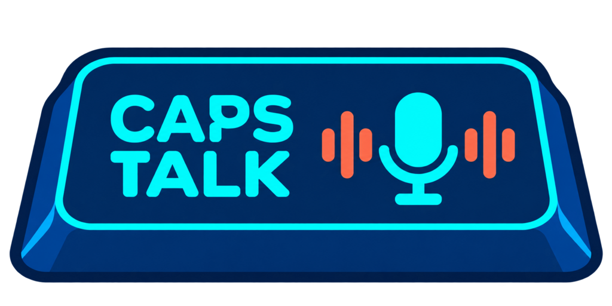
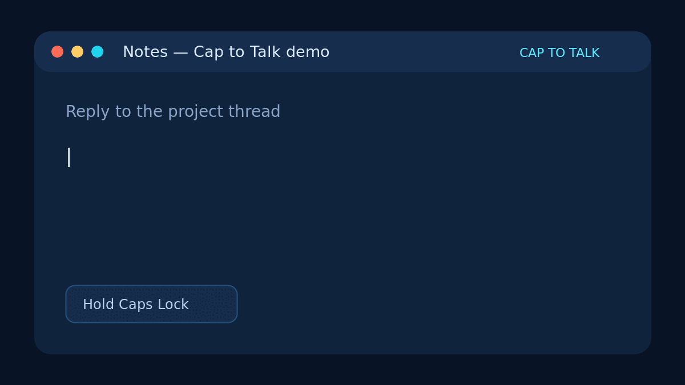

<div align="center">
  
  <h1>Cap To Talk</h1>
  <p><strong>Push-to-talk dictation, local by default.</strong></p>

  [](https://github.com/farrantch/cap-to-talk/actions/workflows/ci.yml)
  [](https://github.com/farrantch/cap-to-talk/releases)
  [](LICENSE)
  
</div>



Hold Caps Lock, speak, and let go. Cap To Talk types what you said into the
window you were using. It transcribes with [OpenASR](https://github.com/QuintinShaw/openasr)
and tidies the wording with [Ollama](https://ollama.com/), all on your machine.
Cloud providers such as OpenAI and Anthropic are optional.

## Install

On Linux (X11) or macOS 15+, run:

```bash
/bin/bash -c "$(curl -fsSL https://raw.githubusercontent.com/farrantch/cap-to-talk/main/install.sh)"
```

It asks how Cap To Talk should turn speech into text:

| Setup | What it uses |
| --- | --- |
| Local models (default) | OpenASR and Ollama on your computer: private, free, no account |
| Claude cleanup | Local speech recognition, wording cleaned up by Claude (Anthropic API key) |
| OpenAI | OpenAI `gpt-audio-1.5` for everything (OpenAI API key) |
| Later | Only the app; choose [providers](docs/providers.md) yourself |

Local models come in three sizes: standard (about 3.5 GB, 8 GB of RAM), light
(2.4 GB, 4 GB of RAM), or best (7.6 GB, 16 GB of RAM). For a cloud setup, paste
your API key when asked, or press Enter and add it later. Keys go into Keychain
on macOS or your login keyring on Linux, never into a file.

Run the command again to update; your choices are kept. To pass options, add
them after `--`, for example `... install.sh)" -- --autostart`:

| Option | Effect |
| --- | --- |
| `--setup local\|claude\|openai\|later` | Choose the setup without being asked |
| `--size standard\|light\|best` | Choose the local model size |
| `--yes` | Accept the defaults (local, standard) |
| `--autostart` | Linux: start Cap To Talk at login |
| `--uninstall` | Remove Cap To Talk; add `--purge` to delete settings too |

After installing:

- **Linux:** Cap To Talk starts right away. Later, open it from your applications
  menu. It needs an X11 session (not Wayland) on Ubuntu 24.04+ or a similar distribution.
- **macOS:** Open Cap To Talk and click **Start dictation**. Enable it under
  **System Settings > Privacy & Security > Accessibility** and **Input Monitoring**,
  then quit and reopen it and start dictation again. Beta builds are not signed
  by Apple, so macOS asks for these permissions again after each update.
- **Windows (experimental):** download the installer from
  [Releases](https://github.com/farrantch/cap-to-talk/releases) and choose
  providers in its settings window.

## Use

| Hold, then release | Result |
| --- | --- |
| Caps Lock | Transcribe, clean up, and type the text |
| Shift + Caps Lock | Type the raw transcription |

Cap To Talk remaps Caps Lock while it runs and restores it when it stops. To use
a function key instead, set `[input].hotkey = "f9"` or pick one in the desktop app.

## Configuration

| Platform | Settings folder |
| --- | --- |
| Linux | `~/.config/cap-to-talk/` |
| macOS | `~/Library/Application Support/cap-to-talk/` |
| Windows | `%APPDATA%\cap-to-talk\` |

- `config.toml` holds the audio, shortcut, provider, and privacy settings. Every
  option is described in [`config.example.toml`](config/config.example.toml).
- `hotwords.txt` lists up to 128 names and terms that help recognition.
  `master-hotwords.txt` is a larger spelling list for cleanup. Put one term per
  line and restart Cap To Talk after editing.
- [AI providers](docs/providers.md) covers cloud services, API keys, and custom endpoints.

## Privacy

With the local setup, audio and text stay on your machine. Recordings are kept
in memory, and transcripts are not logged unless debug logging is on. A cloud
provider you choose receives your audio or transcript; see
[data handling](docs/providers.md#data-handling-and-failure-behavior).

## Troubleshooting

Run `cap-to-talk check` on Linux, or click **Check setup** in the desktop app.
Logs are in `~/.local/state/cap-to-talk/` on Linux; OpenASR's macOS log is
`~/Library/Logs/cap-to-talk/openasr.log`. See
[desktop integrations](docs/desktop.md) for platform details.

## Contributing

See [CONTRIBUTING.md](CONTRIBUTING.md) for development setup. Report security
issues privately as described in [SECURITY.md](SECURITY.md).

Cap To Talk builds on [OpenASR](https://github.com/QuintinShaw/openasr),
[Ollama](https://ollama.com/), and the Qwen speech and language models; review
their licenses and usage terms. Cap To Talk itself is released under the
[MIT License](LICENSE).
